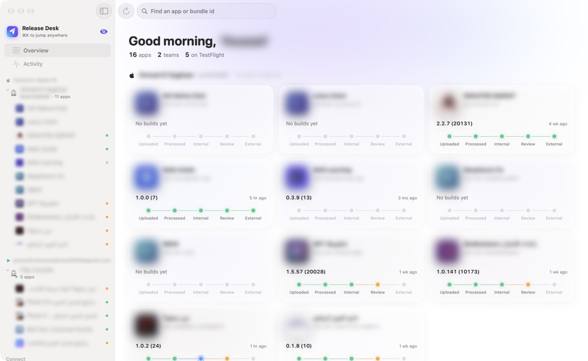
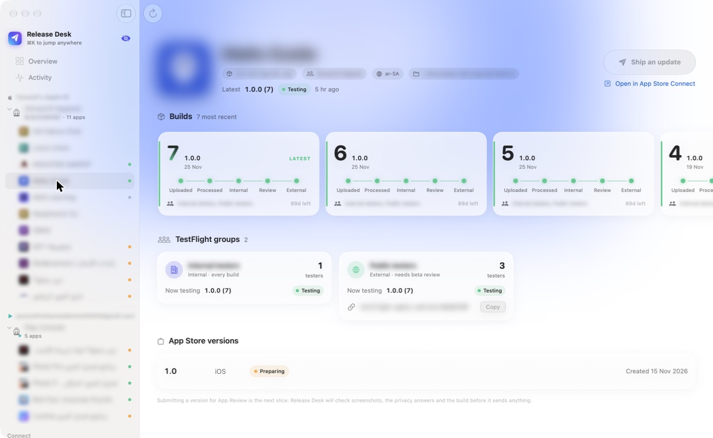
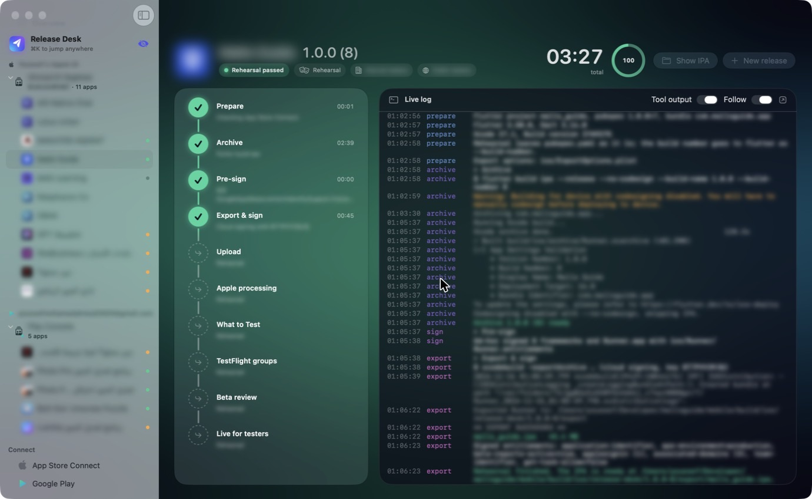
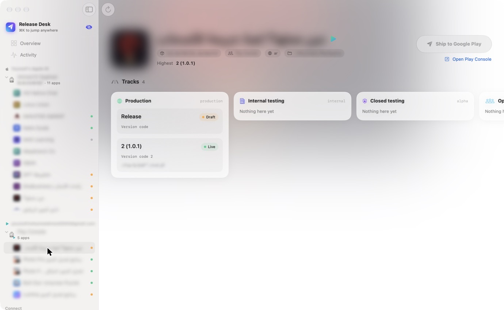

# Release Desk

A native macOS app for shipping mobile apps to **App Store Connect / TestFlight** and **Google Play**. It keeps every account and team apart, shows every app, build, tester group, Play track and version in one place, and ships an update with one button. You watch each step as it runs, on your Mac or on GitHub Actions.



▶︎ **Tour video (2 min, Arabic captions):** download `Release-Desk-Tour.mp4` from the [latest release](../../releases/latest).

## Install

1. Download `ReleaseDesk-<version>.zip` from [Releases](../../releases/latest), unzip it, and move **Release Desk** to Applications.
2. The app is not notarized yet, so macOS stops it the first time. Open it once, then go to **System Settings → Privacy & Security → Open Anyway**. You can also run this:
   ```bash
   xattr -dr com.apple.quarantine "/Applications/Release Desk.app"
   ```
3. Needs **macOS 26** or later, on Apple silicon or Intel. To build apps on this Mac you also need Xcode and Flutter. With GitHub Actions builds, you don't.

## What it does

| | |
|---|---|
|  | **Accounts → teams → apps.** Connect an App Store Connect API key per team. The `.p8` file is found for you, checked with Apple, and kept in your Keychain. Each app page shows its builds as tickets, its TestFlight groups with tester counts and invite links, and its App Store versions. |
|  | **Ship.** Link the Flutter project once. Release Desk suggests the build number, the tester groups and the What to Test text for each language, and lists the commits since the last upload. **Rehearsal** archives, signs and exports without uploading. **Launch** does the whole run. |
|  | **Watch it.** The steps run in order: archive, pre-sign, export with cloud signing, upload, processing, What to Test, groups, beta review, and live for testers. A live log runs next to them. If a step fails after the upload, you resume from that point. You also get notifications, a menu bar item and a Dock badge. |
|  | **No Mac needed for the build.** Choose **Build on → GitHub Actions**. Release Desk adds a workflow to your project and sets the repository's secrets from the team's key, using the GitHub CLI. A GitHub macOS runner archives, signs and uploads, and Release Desk then does the TestFlight steps through the API. |
|  | **App Store review.** Pick or create the version, attach a processed build, write What's New, and choose whether it goes live as soon as it is approved or when you release it. Release Desk shows what is still missing (texts, screenshots, privacy policy URL, build) before it submits. You can cancel while the version waits for review, and release an approved version with one click. |
|  | **New app wizard (⌘N).** Start from a Flutter project or create a new one, and register the bundle id. Release Desk opens App Store Connect and Play Console with every value ready to paste, and each step turns green by itself when the app appears. Then it creates the TestFlight groups and an Android upload key (its password goes to the Keychain), and you ship the first build to both stores. |
|  | **Google Play.** Sign in with your own Google account. Each app shows its tracks (internal, closed, open, production) and their releases. Ship builds an app bundle, refuses a debug-signed one, uploads it, and releases it to the track you choose: full, staged with a percentage, or as a draft. It can also build on GitHub Actions: a Linux runner signs the bundle with your upload key, and Release Desk uploads it, so no Google credential goes to GitHub. |

Also: **⌘K** jumps to any app, team or action. **Privacy mode** (⇧⌘P, the eye in the sidebar) blurs names, emails, ids, paths, notes and logs so you can share your screen. Every screenshot here was taken with it on. You can drop a `.p8` or `.json` on the window or on the Dock icon to connect it, and release notes are kept as drafts.

## Set up

**App Store Connect.** In App Store Connect go to Users and Access → Integrations → App Store Connect API, and create a key with the App Manager or Admin role. Then in Release Desk use **Connect → App Store Connect**, pick the `.p8` file, and paste the Issuer ID.

**Google Play.** Release Desk signs in with an OAuth client that you own:
1. In Google Cloud, create a project, then turn on the **Google Play Android Developer API** and the **Google Play Developer Reporting API**.
2. Set up the OAuth consent screen (Audience: External) and add your Google account as a test user.
3. Create an OAuth client of type **Desktop app** and download its `client_secret_….json`.
4. In Release Desk use **Connect → Google Play**, give it that file, then **Sign in with Google**.

You can also connect a service account key instead. Invite the service account in Play Console under Users and permissions first.

**GitHub Actions builds.** Sign in with the GitHub CLI (`gh auth login`), then choose **GitHub Actions** on the Ship screen. Commit and push the workflow that Release Desk adds (`.github/workflows/release-desk-ios.yml` for iOS, `release-desk-android.yml` for Android), and let it set the repository's secrets: the App Store Connect key, or the upload keystore from `android/key.properties`. Keep in mind that macOS minutes on private repositories cost more than Linux minutes.

## Build from source

```bash
git clone https://github.com/youssef-mohamed07/release-desk.git
cd release-desk
scripts/build-app.sh --open   # signs with your Apple Development identity, or ad hoc
swift test
```

`scripts/package.sh` makes the universal, ad-hoc signed zip that goes on the releases page. `scripts/make-tour-video.swift` renders the tour video from screenshots and captions.

The command line tool `rdesk` (`swift run rdesk …`) reads the same data. It covers App Store Connect apps, builds, groups and versions, Play apps and tracks, and it prints the cloud workflow.

## Where things are kept

- Keys and sign-ins: the login Keychain, under the service `app.releasedesk.credentials`.
- Accounts, teams, project links and run history: `~/Library/Application Support/Release Desk/workspace.json`.
- Run logs: `~/Library/Application Support/Release Desk/Logs/`.

Nothing leaves your Mac except calls to Apple, Google and GitHub.

## بالعربي

**Release Desk** تطبيق لنظام ماك يرفع تطبيقاتك على App Store و Google Play من مكان واحد. نزّل ملف zip من صفحة Releases وانقل التطبيق إلى Applications، وفي أول مرة افتحه من System Settings ← Privacy & Security ← Open Anyway. بعد ذلك اربط حساب Apple بمفتاح API، وسجّل الدخول بحساب Google، واختر مشروعك، ثم اضغط Launch. وإن لم يكن لديك ماك للبناء، اختر GitHub Actions ليبني ماك من GitHub التطبيق ويرفعه. الفيديو في صفحة Releases يشرح كل خطوة.
