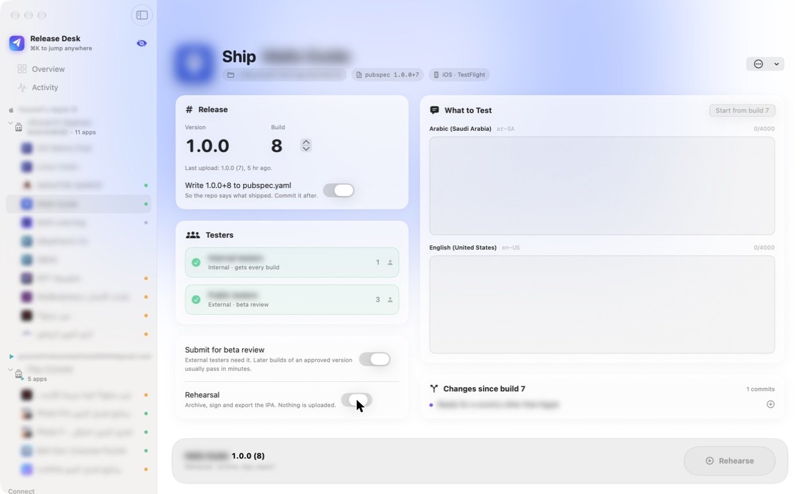
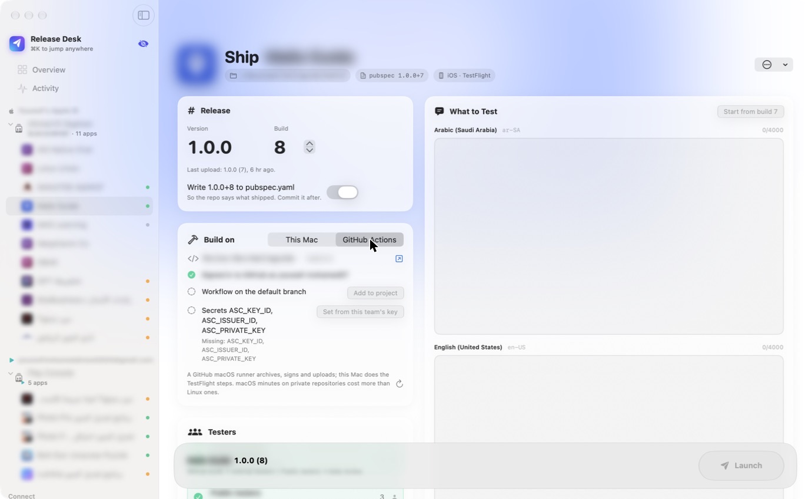

# Release Desk

A native macOS app for shipping mobile apps to **App Store Connect / TestFlight** and **Google Play**. It keeps every account and team apart, shows every app, build, tester group, Play track and App Store version in one place, and ships an update with one button. You watch each step as it runs, on your Mac or on GitHub Actions.


▶︎ **Tour video (2 min, Arabic captions):** `Release-Desk-Tour.mp4` on the [latest release](../../releases/latest).

## Install

1. Download `ReleaseDesk-<version>.zip` from [Releases](../../releases/latest), unzip it, and move **Release Desk** to Applications.
2. The app is not notarized yet, so macOS stops it the first time. Open it once, then go to **System Settings → Privacy & Security → Open Anyway**. Or run:
   ```bash
   xattr -dr com.apple.quarantine "/Applications/Release Desk.app"
   ```
3. It needs **macOS 26** or later, on Apple silicon or Intel.
   - iOS builds on this Mac need **Xcode** and **Flutter**.
   - Android builds on this Mac need **Flutter** with the **Android SDK** (Release Desk checks the signature with `keytool`, from `JAVA_HOME`, Android Studio's JBR or `PATH`).
   - Builds on **GitHub Actions** need neither, only the [GitHub CLI](https://cli.github.com) signed in.

### Windows and Linux

There is also a Flutter version for Windows and Linux in [`desktop/`](desktop). It shows the same App Store Connect, TestFlight and Google Play data, ships iOS through GitHub Actions and Android on the computer or on GitHub. Its builds are not on the releases page yet; until they are, build it from source. See [desktop/README.md](desktop/README.md), which also lists what it doesn't do yet.

## What it does

| | |
|---|---|
|  | **Accounts → teams → apps.** Connect one App Store Connect API key per team. Release Desk looks for `AuthKey_….p8` files in `~/.appstoreconnect/private_keys`, `~/private_keys`, `~/.private_keys` and `~/Downloads`, checks the key with Apple, and keeps it in your Keychain. Each app page shows its builds as tickets (click one for its details), its TestFlight groups with tester counts and public links, and its App Store versions. |
|  | **Ship.** Link the Flutter project once. Release Desk suggests the next build number (above the highest one on App Store Connect and the one in `pubspec.yaml`) and the tester groups you used last. What to Test has a box for Arabic and one for English; it can start from the last build's text, and the commits since the last upload are listed so you can add any of them with **+**. It can write the version and build to `pubspec.yaml`. **Rehearsal** archives, signs and exports without uploading. **Launch** (⌘Return) does the whole run. |
|  | **Watch it.** The launch console shows each step with its time and a live log. An iOS release on this Mac runs: Prepare, Archive, Pre-sign (only with cloud signing), Export & sign, Upload, Apple processing, What to Test, TestFlight groups, Beta review, Live for testers. What to Test is skipped when it is empty, and Beta review when it is off or only internal groups are picked. If an iOS run fails after the upload, **Resume** picks up from Apple processing without uploading again; other runs start over with **Try again**. You also get a notification when a run ends, a menu bar item with the last runs, and a Dock badge while releases run. |
|  | **No Mac needed for the build.** Choose **Build on → GitHub Actions**. Release Desk writes `.github/workflows/release-desk-ios.yml` into your project (you commit and push it) and sets the repository secrets `ASC_KEY_ID`, `ASC_ISSUER_ID` and `ASC_PRIVATE_KEY` from the team's key with `gh secret set`. A GitHub macOS runner archives, signs and uploads; Release Desk then runs Apple processing, What to Test, TestFlight groups, Beta review and Live for testers through the API. |
|  | **Google Play.** Sign in with your own Google account, or use a service account. Each app shows its tracks (Internal, Closed, Open, Production, and any custom track) with their releases. Ship builds an app bundle, refuses one signed with the debug key, uploads it, and releases it to the track you choose: in full, staged with a percentage, or as a draft. An app that is still a draft on Play gets a draft release. What's new is limited to 500 characters, in English and Arabic. Android can also build on GitHub Actions (`release-desk-android.yml`): a Linux runner signs the bundle with your upload key from the secrets `ANDROID_KEYSTORE_BASE64`, `ANDROID_KEYSTORE_PASSWORD`, `ANDROID_KEY_ALIAS` and `ANDROID_KEY_PASSWORD`, and Release Desk downloads it and releases it, so no Google credential goes to GitHub. |

**App Store review.** Choose **Submit for review…** on an app page, or **Submit to App Store…** in the console after a successful iOS run. Pick or create the version, attach a processed build, write What's New (for an app that has shipped before), and choose whether it goes live **as soon as it is approved** or **manually, when you say**. Release Desk lists what is still missing before it submits: description, keywords, support URL and screenshots for each language, the privacy policy URL, export compliance, and a processed build that has not expired. You can cancel while the version waits for review, and **Release now** an approved version that waits for you.

**New app wizard (⌘N).** Start from a Flutter project or create one (`flutter create` for iOS and Android), then register the bundle id. The wizard opens App Store Connect and Play Console with every value ready to paste (name, bundle id or package, SKU, language), and each step turns green by itself when the app appears there. It then creates two TestFlight groups, **Internal testers** and **Public testers** (with a public link), and an Android upload key: the keystore goes to `~/Library/Application Support/Release Desk/Upload Keys/`, its password to the Keychain and to `android/key.properties`. Keep `key.properties` out of git; the wizard warns when git doesn't ignore it and shows the `build.gradle` lines to add. The first Play release goes in as a draft.

**Also:**
- **⌘K** jumps to any app, team or action; **⌘R** refreshes; **⌘1** opens the overview and **⌘2** the activity list of past runs with their logs.
- **Privacy mode** (⇧⌘P, or the eye in the sidebar) blurs names, icons, emails, ids, paths, notes and logs so you can share your screen. Every screenshot here was taken with it on.
- Drop a `.p8` or `.json` (OAuth client or service account) on the window or the Dock icon to connect it.
- Release notes are kept as drafts until the release ships.
- Removing a team also deletes its key from the Keychain. On a Google Play account you can add or remove apps by package name.

## Set up

**App Store Connect.** In App Store Connect go to Users and Access → Integrations → App Store Connect API, and create a key with the App Manager or Admin role. In Release Desk use **Connect → App Store Connect**, pick the `.p8` file (the Key ID is filled from a file named `AuthKey_<KEYID>.p8`), and paste the Issuer ID.

**Google Play.** Release Desk signs in with an OAuth client that you own:
1. In Google Cloud, create a project, then turn on the **Google Play Android Developer API** and the **Google Play Developer Reporting API**.
2. Set up the OAuth consent screen (Audience: External) and add your Google account as a test user.
3. Create an OAuth client of type **Desktop app** and download its `client_secret_….json`.
4. In Release Desk use **Connect → Google Play**, give it that file, then **Sign in with Google**.

Or connect a service account key instead; invite the service account in Play Console under Users and permissions first.

**GitHub Actions builds.** Sign in with the GitHub CLI (`gh auth login`), then choose **GitHub Actions** on the Ship screen. Commit and push the workflow that Release Desk adds, and let it set the repository secrets. macOS minutes on private repositories cost more than Linux minutes.

## Build from source

```bash
git clone https://github.com/youssef-mohamed07/release-desk.git
cd release-desk
scripts/build-app.sh --open   # signs with $SIGN_IDENTITY, else your Apple Development identity, else ad hoc
swift test
```

| Script | What it does |
|---|---|
| `scripts/build-app.sh [--open]` | Builds `build/Release Desk.app`. |
| `scripts/package.sh` | Makes the universal, ad-hoc signed `build/dist/ReleaseDesk-<version>.zip` for the releases page. |
| `swift scripts/make-icon.swift <out.iconset>` | Draws the app icon. |
| `swift scripts/make-tour-video.swift tour.json out.mp4` | Renders the tour video from screenshots and captions. |
| `scripts/make-music.swift`, `scripts/make-promo.swift` | Write the promo soundtrack and render the promo video (16:9, `--tiktok` 9:16, `--poster` one still). Usage and the ffmpeg lines are at the top of each file. |

**`rdesk`**, the command line tool (`swift run rdesk …`), talks to the APIs directly; it doesn't read the app's accounts or Keychain.

```text
rdesk apps|team --key-id ID --issuer ISSUER [--key-file PATH]
rdesk builds|groups|versions|readiness --key-id ID --issuer ISSUER --app APP_ID [--key-file PATH]
rdesk bundle --key-id ID --issuer ISSUER --bundle BUNDLE_ID [--key-file PATH]
rdesk play-apps --json SERVICE_ACCOUNT.json
rdesk play-tracks --json SERVICE_ACCOUNT.json --package PACKAGE
rdesk workflow [--android] [--dir mobile] [--team TEAMID] [--flutter 3.x]
```

`--key-file` defaults to `~/.appstoreconnect/private_keys/AuthKey_<ID>.p8`.

## Where things are kept

- Keys, Google sign-ins, the OAuth client and upload key passwords: the login Keychain, under the service `app.releasedesk.credentials`.
- Accounts, teams, project links and run history: `~/Library/Application Support/Release Desk/workspace.json`.
- Run logs: `~/Library/Application Support/Release Desk/Logs/`.
- Upload keystores made by the wizard: `~/Library/Application Support/Release Desk/Upload Keys/`.

Nothing leaves your Mac except calls to Apple, Google and GitHub.

## بالعربية

**Release Desk** تطبيق لنظام macOS يرفع تطبيقاتك على App Store و Google Play من مكان واحد.

1. نزّل ملف zip من صفحة Releases، وانقل التطبيق إلى مجلد Applications. في أول مرة افتحه، ثم اذهب إلى System Settings ← Privacy & Security ← Open Anyway.
2. اربط حساب Apple بمفتاح App Store Connect API لكل فريق، وسجّل الدخول بحساب Google.
3. اختر مشروع Flutter، واكتب نص What to Test، ثم اضغط Launch.

يحتاج macOS 26 أو أحدث. للبناء على جهازك تحتاج Xcode و Flutter لـ iOS، و Flutter مع Android SDK لـ Android. وإن لم يكن لديك ما يلزم، اختر GitHub Actions ليبني جهاز من GitHub التطبيق ويرفعه. الفيديو في صفحة Releases يشرح كل خطوة.
