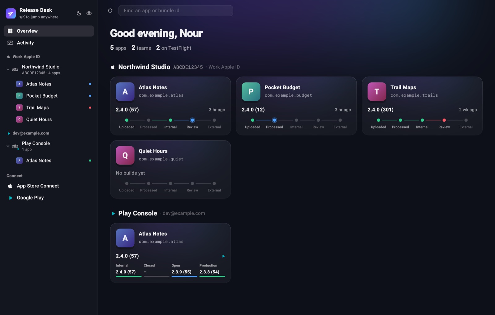
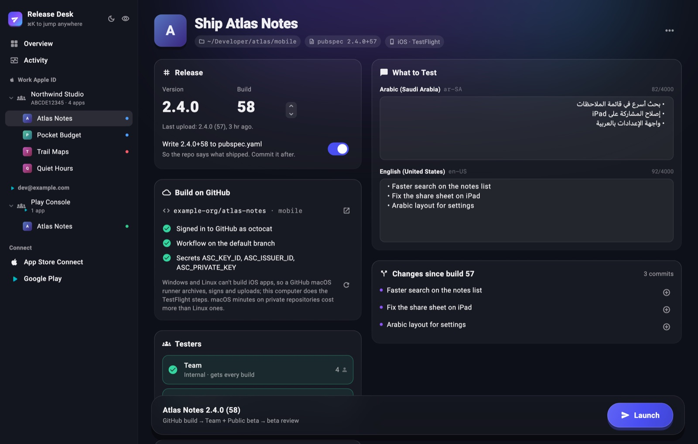

# Release Desk for Windows and Linux

The Windows and Linux version of Release Desk, written in Flutter. Like the macOS app in the root of this repository, it ships mobile apps to **App Store Connect / TestFlight** and **Google Play**: accounts and teams kept apart, every app, build, tester group and Play track in one place, and a launch console that shows each step of a release as it runs.



It uses the same GitHub Actions workflows as the macOS app (`release-desk-ios.yml`, `release-desk-android.yml`, with the same inputs, secret names and `release-desk-aab` artifact), so a project set up from one app works from the other.

## Install

The Windows and Linux builds are made by the `Desktop (Windows and Linux)` workflow when a `v*` tag is pushed, and attached to that tag's release. **No release has them yet**; until one does, [build from source](#build-from-source).

**Windows** (10 or later, x64)

1. Download `ReleaseDesk-windows-x64.zip` from the release and unzip it anywhere. It includes the Visual C++ runtime files it needs.
2. Run `ReleaseDesk\release_desk.exe`. The app is not signed, so SmartScreen may stop it the first time: choose **More info → Run anyway**.

**Linux** (x64, GTK 3)

1. Download `ReleaseDesk-linux-x64.tar.gz` from the release.
2. Unpack and run it:
   ```bash
   tar -xzf ReleaseDesk-linux-x64.tar.gz
   ./ReleaseDesk/release_desk
   ```
3. It needs GTK 3, libsecret and a keyring service. On Ubuntu or Debian:
   ```bash
   sudo apt install libgtk-3-0 libsecret-1-0 gnome-keyring
   ```
   KDE's KWallet should work too, through its Secret Service support.

## What needs a Mac, and what doesn't

| | Windows / Linux |
|---|---|
| See App Store Connect apps, builds, TestFlight groups and versions | Yes |
| Ship iOS to TestFlight | Yes, built on **GitHub Actions**: a GitHub macOS runner archives, signs and uploads; this computer then waits for Apple processing, sets What to Test, adds the build to the groups, submits it for beta review and waits until testers can install it |
| Build iOS on this computer | No. Apple's tools only run on macOS |
| See Google Play apps and tracks | Yes |
| Ship Android to Play | Yes, built on this computer (Flutter, Android SDK and Java) **or** on GitHub Actions (a Linux runner builds and signs the bundle; this computer downloads it and releases it on Play) |

**Not in this version yet** (the macOS app has them): App Store review submission, the new app wizard, Google Play service accounts (only Google sign-in here), dropping key files on the window, notifications, and the `rdesk` command line tool.

## Set up

**App Store Connect.** In App Store Connect go to Users and Access → Integrations → App Store Connect API and create a key with the App Manager or Admin role. In Release Desk choose **Connect → App Store Connect** and pick the `AuthKey_….p8` file; Release Desk also looks for one in `~/.appstoreconnect/private_keys`, `~/private_keys`, `~/.private_keys` and `~/Downloads`, and reads the Key ID from the file name. Paste the Issuer ID and press **Verify**: Release Desk lists the apps the key sees and reads the team ID. **Connect** saves it.

**Google Play.** Release Desk signs in with an OAuth client that you own:

1. In Google Cloud, create a project and turn on the **Google Play Android Developer API** and the **Google Play Developer Reporting API**.
2. Set up the OAuth consent screen (Audience: External) and add your Google account as a test user.
3. Create an OAuth client of type **Desktop app** and download its `client_secret_….json`.
4. In Release Desk choose **Connect → Google Play**, give it that file (one in `~/Downloads` is found for you), then **Sign in with Google**. Your browser opens; after you allow access it returns to a one-time listener on `127.0.0.1` (OAuth for installed apps, with PKCE).

Apps come from the Reporting API. If it doesn't list them yet, name their packages in the Connect dialog, or add them later on the Play team's page.

**GitHub Actions builds.** Install the [GitHub CLI](https://cli.github.com) and sign in with `gh auth login`. Release Desk uses a token you save with **Use a token…** on the Ship screen, or else the GitHub CLI's token; setting repository secrets always goes through the GitHub CLI, so it must be signed in. The **Build on GitHub** checklist then:

- writes the workflow into your project (`.github/workflows/release-desk-ios.yml` or `release-desk-android.yml`). Commit and push it to the default branch;
- sets the repository secrets with `gh secret set`, from the team's App Store Connect key (`ASC_KEY_ID`, `ASC_ISSUER_ID`, `ASC_PRIVATE_KEY`) or from `android/key.properties` (`ANDROID_KEYSTORE_BASE64`, `ANDROID_KEYSTORE_PASSWORD`, `ANDROID_KEY_ALIAS`, `ANDROID_KEY_PASSWORD`).

macOS minutes on private repositories cost more than Linux minutes.

**Android builds on this computer** need Flutter, the Android SDK and an `android/key.properties` with your upload key. Release Desk checks the bundle's signature with `keytool`, found through `JAVA_HOME`, Android Studio's JBR or `PATH`, and refuses a bundle signed with the debug key, except in a rehearsal. If it can't find `keytool`, it skips that check and says so in the log.

## Using it



- **Overview** shows every App Store Connect app with a five-light lane (Uploaded, Processed, Internal, Review, External), and every Google Play app with its tracks.
- **Ship** links the Flutter project once, suggests the next build number (above the highest one on the store and the one in `pubspec.yaml`), and keeps release notes as drafts. **Rehearsal** builds without uploading. **Ctrl+Enter** launches.
- The **launch console** shows each step with its time and a live log. If an iOS release stops after GitHub has uploaded the build, **Resume from Apple processing** picks it up there.
- **Ctrl+K** (⌘K on macOS) jumps to any app, team or action. **Ctrl+Shift+P**, or the eye in the sidebar, turns on privacy mode, which blurs names, ids, emails, paths, notes and logs for screen sharing. **Ctrl+R** refreshes, **Ctrl+1** opens the overview and **Ctrl+2** the activity list.

## Where things are kept

- Accounts, teams, project links and run history (no secrets): `workspace.json` in `%APPDATA%\Release Desk\` on Windows, or in `$XDG_CONFIG_HOME/release-desk/` (by default `~/.config/release-desk/`) on Linux.
- Settings (privacy mode, theme) and release note drafts: `settings.json` in the same folder.
- Run logs: the `Logs` folder in the same folder.
- Keys, Google sign-ins, the OAuth client and a saved GitHub token: on Windows a file encrypted with DPAPI for your Windows user (`%APPDATA%\Release Desk\Release Desk\flutter_secure_storage.dat`); on Linux the Secret Service, through libsecret.

Nothing leaves your computer except calls to Apple, Google and GitHub.

## Build from source

```bash
cd desktop
flutter pub get
flutter test
flutter build windows --release   # on Windows
flutter build linux --release     # on Linux
```

Linux builds need at least `clang cmake ninja-build pkg-config libgtk-3-dev libsecret-1-dev`; CI also installs `liblzma-dev libstdc++-12-dev libjsoncpp-dev`. The macOS target exists only to develop the app on a Mac; use the native macOS app there.

The `Desktop (Windows and Linux)` workflow in `.github/workflows/desktop.yml` builds both on GitHub Actions, by hand or on a `v*` tag. On a tag it attaches `ReleaseDesk-windows-x64.zip` and `ReleaseDesk-linux-x64.tar.gz` to the tag's release; a manual run keeps them as workflow artifacts.

`flutter test` covers the App Store Connect ES256 token (the signature is checked against the key's public point), the workflows (against golden files that match the macOS app's), Google's PKCE and loopback sign-in, project and git remote reading, the workspace JSON (round trip, no secrets), artifact unpacking, the release steps, and it renders every screen with sample data. With `RD_SHOTS=<folder>` it also saves a picture of each screen; `RD_SCALE=2` makes them sharper, and `RD_PROMO=1` uses a stand-in person and a release that is ready to launch, for videos.
